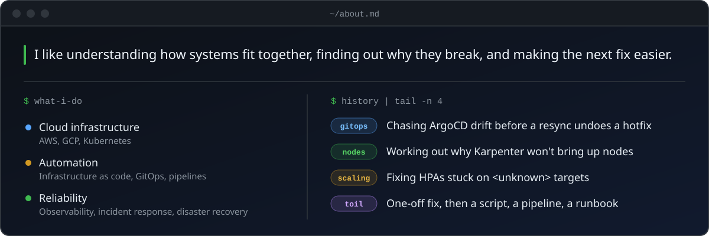

<picture>
  <source media="(max-width: 600px)" srcset="https://raw.githubusercontent.com/dakshayahuja/dakshayahuja/main/assets/banner-mobile.svg" />
  
</picture>

 

&nbsp;&nbsp;&nbsp;

## About

<picture>
  <source media="(max-width: 600px)" srcset="https://raw.githubusercontent.com/dakshayahuja/dakshayahuja/main/assets/about-mobile.svg" />
  
</picture>

## Toolchain

  
  
  
  
  
  
  
  
  
   
  
  
  
  
  
  
  
  
  

<!--
CERTIFICATIONS: hidden until there are professional certs to show.
To restore: remove this comment wrapper. Keep it collapsible.

## Certifications

  
Show certifications

   
  
  
  

-->

 

  <samp>infrastructure as code · docs as code · calm pagers</samp>

